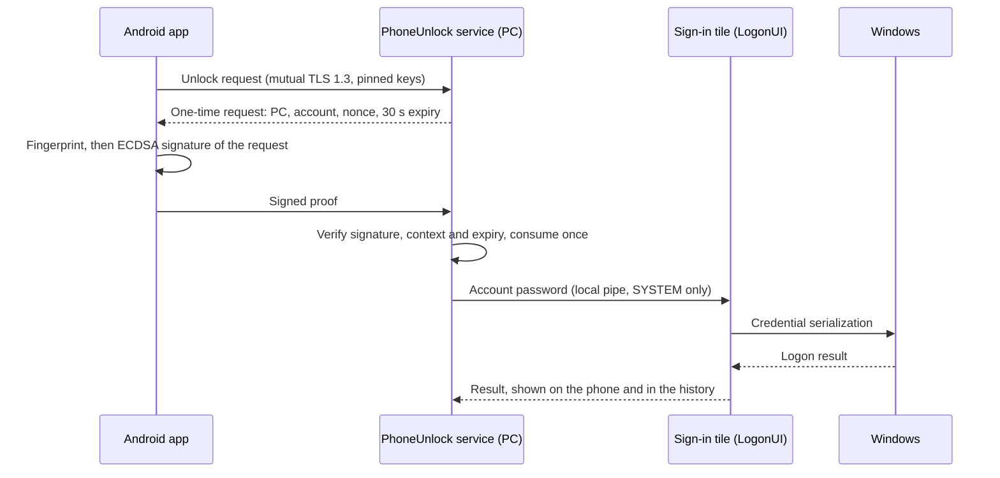

# PhoneUnlock for Windows

[](LICENSE)


Unlock or sign in to a Windows 11 session with the fingerprint of your Android phone, over your local network, with no cloud service and no account other than your own.

The phone signs a one-time request after a strong biometric check. A local Windows service verifies that signature and hands the account password, kept encrypted on the PC, to a Windows sign-in tile. **Windows alone decides** whether the session opens; PhoneUnlock never bypasses a Windows security mechanism.

> [!WARNING]
> PhoneUnlock keeps your Microsoft account password **encrypted on the PC** so that it can submit it to Windows. Anyone who gains administrator or SYSTEM rights on that PC can recover it, and with it access your Microsoft account online. Read [the security model](docs/security.md) and accept this trade-off before installing. This is a personal project, provided as is, without warranty.

## Features

- **Two ways to unlock**: tap *Unlock* in the phone app, or click *Ask the phone* on the Windows sign-in tile and confirm a 4-digit match code on the phone.
- **Strong biometrics, per request**: every unlock requires a fingerprint (Android Class 3) that authorizes an ECDSA P-256 signature over that exact request, with keys held in StrongBox when available.
- **Live PC state** on the phone: locked, sign-in screen or signed in, and whether an unlock is possible right now.
- **Works without Internet**: same Wi-Fi, or the phone's own hotspot with mobile data off.
- **Nothing replaced**: your PIN, password and Windows Hello stay available on the sign-in screen at all times.
- **Pairing by QR code** with a 6-digit code compared on both screens, then confirmed on the PC and by fingerprint.
- **Administration from the PC**: list and revoke phones, view or clear the history, and run a diagnostic `status`; pairing, revoking and clearing the history require the Windows account password.
- **Installer with rollback**: integrity checks (SHA-256), access-control checks, and automatic undo if any step fails.

## How it works



| Component | Technology | Role |
|---|---|---|
| `android/` | Kotlin, Jetpack Compose, Android Keystore, BiometricPrompt, CameraX | Pairing, PC state, biometric signing |
| `windows/service/` | C++20, Windows service, `http.sys`, CNG, DPAPI | Pairing, request verification, encrypted password store, admin commands |
| `windows/credential-provider/` | C++20, Credential Provider V2 (COM) | The *Phone* tile on the sign-in screen |
| `protocol/SPEC.md` | Deterministic CBOR over HTTPS | Phone ↔ PC protocol |

## Security model

- **Transport**: HTTPS on the local subnet only (port 47863), TLS 1.3 required, mutual authentication, both certificates pinned at pairing.
- **Proof**: a signature over the full request (PC, account SID, sign-in screen context, nonce, expiry), single use, rejected if replayed, late or bound to another screen.
- **Secrets**: the password is encrypted with DPAPI under a dedicated virtual service account; data folders are restricted to SYSTEM, Administrators and the service, and checked at install time.
- **Limits**: 3 unlock requests per minute per account, 16 KB per message, at most 8 concurrent requests.
- **Threat model**: twelve threats from the specification, with their status and evidence, in [docs/security.md](docs/security.md).

## Requirements

**To run**

- Windows 11 x64 with a Microsoft account that has a password (used once online on this PC)
- Smart App Control turned off (the tile is not signed by a recognized authority)
- An Android 11+ phone with a Class 3 (strong) fingerprint sensor
- PC and phone on the same local network

**To build** (all free)

- Visual Studio Build Tools 2022 (MSVC, Windows SDK, CMake) and [vcpkg](https://github.com/microsoft/vcpkg)
- Android SDK and JDK 21 (Gradle comes with the wrapper)

## Build

```powershell
scripts\build-windows.ps1     # builds the service and the tile, runs the tests, writes build\package\PhoneUnlock-<version>
scripts\sign-apk.ps1          # builds the release APK and signs it with your own local key
```

`build-windows.ps1` reads vcpkg from `VCPKG_ROOT`. The Android unit tests run with `android\gradlew.bat testDebugUnitTest`.

## Install

Test in a virtual machine first. The installer refuses physical machines unless you pass `-AllowPhysicalMachine`.

```powershell
# In an elevated PowerShell, from build\package\PhoneUnlock-<version>
powershell -ExecutionPolicy Bypass -File .\install.ps1 -AllowPhysicalMachine
& "C:\Program Files\PhoneUnlock\PhoneUnlockService.exe" provision             # stores your password, verified by Windows
& "C:\Program Files\PhoneUnlock\PhoneUnlockService.exe" pair --endpoint <PC address>:47863
```

Then install the APK on the phone (`adb install -r PhoneUnlock-<version>.apk`), scan the QR code and confirm. The full guide covers updates, diagnostics, uninstallation and **recovery** if you can no longer sign in: [docs/install.md](docs/install.md).

## Project status

Version 0.1.0 is in daily use on its author's PC. Every milestone of the specification is done:

| Milestone | Scope |
|---|---|
| L0–L1 | Tooling, test VM, Windows feasibility with a Microsoft account, online and offline |
| L2 | Protocol specification and threat model |
| L3 | Android app |
| L4 | Windows service and sign-in tile |
| L5 | Installer with rollback, signed APK, diagnostics, documentation |
| L6 | Acceptance testing in a VM, then on a physical PC |

Acceptance results, open issues and known gaps are in [docs/recette.md](docs/recette.md). The automated suites (102 C++ tests, 47 Kotlin tests) pass. Tested on Windows 11 Home (builds 26200 and 26300) and a Google Pixel 5 (Android 14); other phones have not been tested.

## Known limitations

- The phone app must be open when you unlock; it does not run in the background.
- Being on the same network does not prove proximity: an unlock started from the phone opens the session for whoever is in front of the PC.
- After a Microsoft account password change, run `provision` again.
- After *modern standby*, Windows opens the session but does not report the result, so the app waits about 10 seconds.

## Documentation

The detailed documentation is written in French.

| Document | Content |
|---|---|
| [docs/install.md](docs/install.md) | Installation, updates, diagnostics, uninstallation, recovery |
| [docs/security.md](docs/security.md) | Threat model, secrets, limits |
| [docs/architecture.md](docs/architecture.md) | Modules, flows, security boundaries |
| [protocol/SPEC.md](protocol/SPEC.md) | Phone ↔ PC protocol |
| [docs/decisions.md](docs/decisions.md) | Design decisions and deviations from the specification |
| [docs/testing.md](docs/testing.md) | Automated tests and manual procedures with evidence |
| [docs/recette.md](docs/recette.md) | Acceptance report |
| [docs/third-party.md](docs/third-party.md) | Third-party components and licenses |
| [docs/Cahier_des_charges.pdf](docs/Cahier_des_charges.pdf) | Original specification |

## License

PhoneUnlock is released under the [MIT License](LICENSE). Third-party components keep their own licenses (MIT, Apache 2.0, BSD-3-Clause), listed in [docs/third-party.md](docs/third-party.md).

PhoneUnlock is an independent project, not affiliated with or endorsed by Microsoft or Google. Windows, Windows Hello and Android are trademarks of their respective owners.
